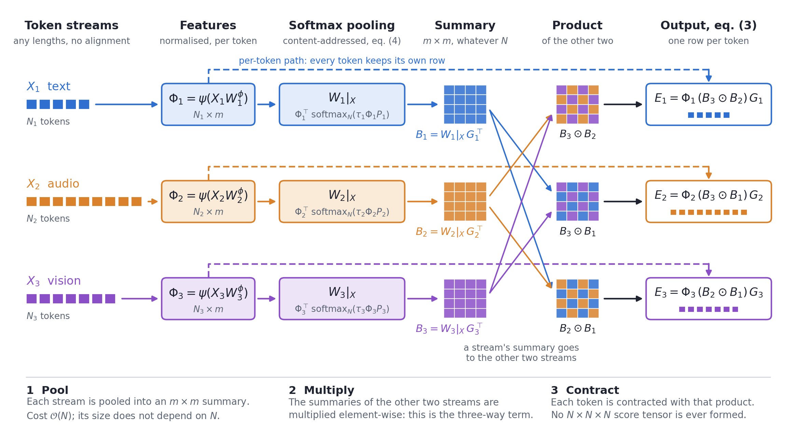

# Three at a Time, in Linear Time: Trimodal Attention from the Kernelizable MLSVD

Code and results for the ESANN paper by Tom Lijding and Kim Batselier.

The paper derives an attention block that couples one token from each of three modalities
at a cost linear in the sequence length, by never forming the N×N×N score tensor. This
repository contains the block, the scripts behind every table and number in the paper, and
the raw results those numbers were computed from.



*How the block fuses three streams. Each stream is pooled into an m×m summary whose size does
not depend on N; the summaries of the other two streams are multiplied element-wise; every
token is then contracted with that product, so no N×N×N score tensor is formed.*

## Contents

| Paper | Code | Stored results | Needs |
|---|---|---|---|
| The block, eqs. (3) and (4) | `primal_block/block.py` | | |
| Section 3, evenness and coupling claims | `experiments/triparity/parity_check.py` | `results/triparity/parity_check.txt` | CPU, seconds |
| Section 3, FLOP ratios and N³ memory limit | `experiments/scaling/flops.py` | `results/scaling/flops.txt` | CPU, seconds |
| Section 3, measured memory | `experiments/scaling/memory.py` | `results/scaling/memory.json` | one GPU, patched MMSA, minutes |
| Table 1, TriParity | `experiments/triparity/triparity.py` | `results/triparity/table1.json` | one GPU, under an hour |
| Table 2, CMU-MOSEI | `experiments/mosei/` | `results/mosei/logs/` | one GPU, MMSA and its MOSEI features |

## Install

```bash
pip install -e .
```

This installs `primal_block` with PyTorch and NumPy, which is all the block, TriParity and
the FLOP count need (tested with Python 3.11 and PyTorch 2.9.1). The MOSEI experiment and
the memory measurement run inside MMSA; see `experiments/mosei/README.md`.

## The block

```python
import torch
from primal_block import PrimalBlock

block = PrimalBlock(dim=64, num_heads=4, rank=16)
text, audio, vision = torch.randn(8, 50, 64), torch.randn(8, 500, 64), torch.randn(8, 375, 64)
text, audio, vision = block(text, audio, vision)     # same shapes; streams may differ in length
```

`PrimalAttention` is the fusion operation alone and `PrimalBlock` wraps it in a pre-norm
transformer block per stream. Two arguments select the block of the paper and its ablations:

| Table 1 row | `pooling` | `core` |
|---|---|---|
| Primal block (ours) | `"softmax"` | `"free"` |
| Lin. pooling | `"linear"` | `"free"` |
| W_d\|X core | `"softmax"` | `"gram"` |
| Static W_d | `"static"` | `"gram"` |

## Reproducing the paper

### Table 1: TriParity

```bash
python experiments/triparity/triparity.py --out table1.json      # all rows, 3 seeds
python experiments/triparity/triparity.py --show results/triparity/table1.json
```

`--rows`, `--orders` and `--seeds` select a subset, for example
`--rows ours,static --orders 3 --seeds 1` for a two-minute check. `--gpu N` picks the GPU and
`--device cpu` runs without one. The stored results were produced with PyTorch 2.9.1 and
reproduce exactly on that version; other versions can differ in the last digit (one held-out
sample in 5,000 on PyTorch 2.4.1). The script holds the data
generator, every mechanism of the table and the training loop in one file.

### Section 3: structural claims

```bash
python experiments/triparity/parity_check.py
```

Measures, on the fusion operation at initialisation, how much stream 1's output changes
when stream 2 is replaced, and what share of that change is odd in stream 2. Static
weights give no coupling; the Gram core is even (exactly with linear pooling, approximately
with softmax pooling); the free core is odd.

### Section 3: cost

```bash
python experiments/scaling/flops.py
python experiments/scaling/memory.py --out memory.json      # needs the patched MMSA
```

`flops.py` states the closed-form operation counts of the primal operation and of MulT's
pairwise cross-attention, checks both for equality against PyTorch's FLOP counter, and
prints their ratio over N together with the largest N at which an explicit float32 N³
tensor fits in 24 GiB. `memory.py` measures the peak GPU memory of the two fusion stages as
built for MOSEI, and the largest N each can run.

### Table 2: CMU-MOSEI

See `experiments/mosei/README.md`. The stored logs reproduce the table without training:

```bash
pip install scipy
python experiments/mosei/report.py results/mosei/logs
```

## Layout

```
primal_block/            the block
experiments/triparity/   Table 1 and the parity check
experiments/scaling/     FLOP count and memory measurement
experiments/mosei/       MMSA patch, run and report scripts for Table 2
results/                 raw outputs behind the numbers in the paper
images/                  the figure above and the script that draws it
```

## Licence

MIT, see `LICENSE`. The MOSEI experiment builds on [MMSA](https://github.com/thuiar/MMSA)
(MIT), which is not redistributed here.
